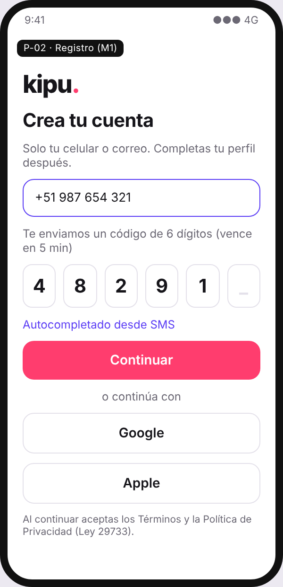
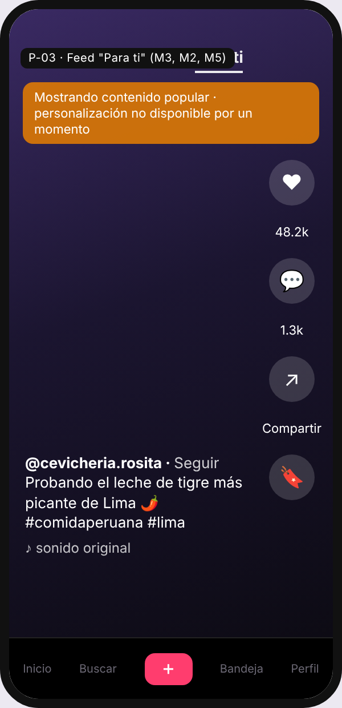
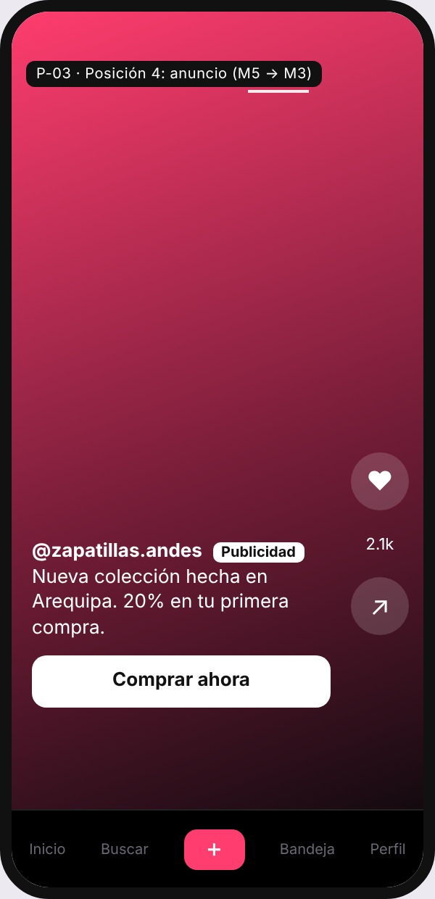
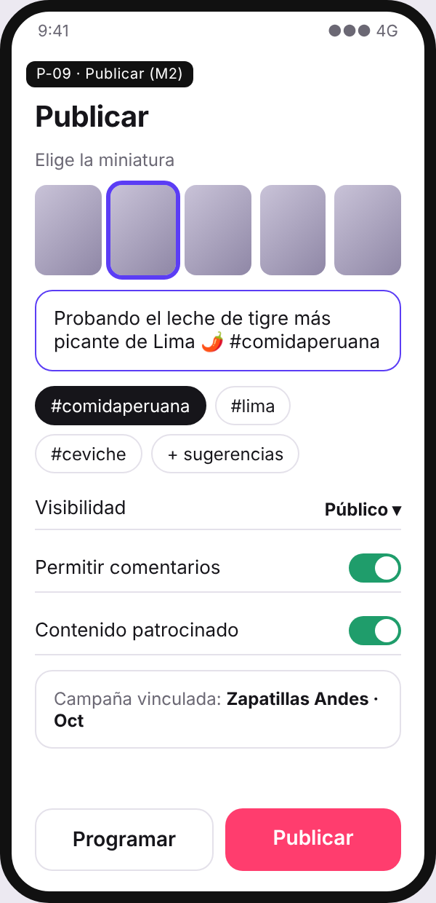
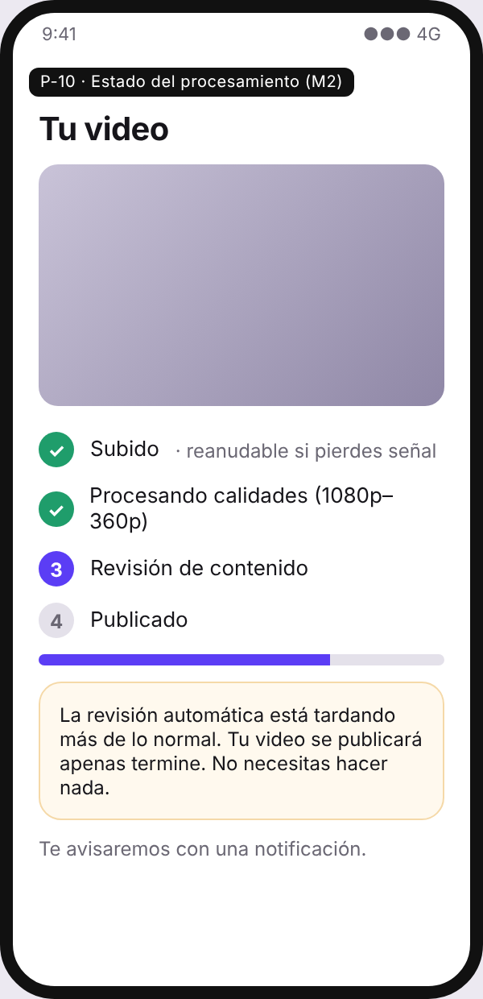
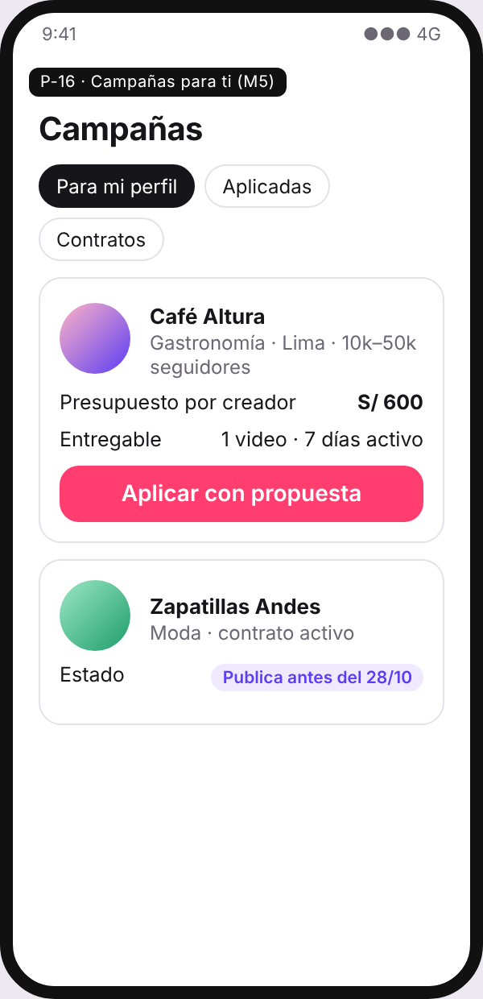
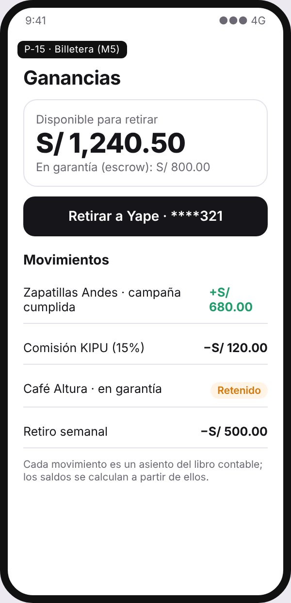
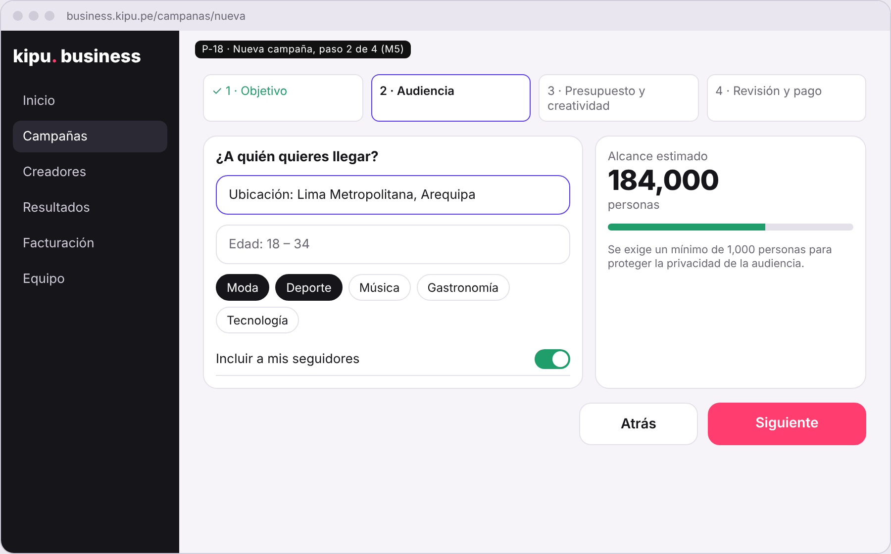
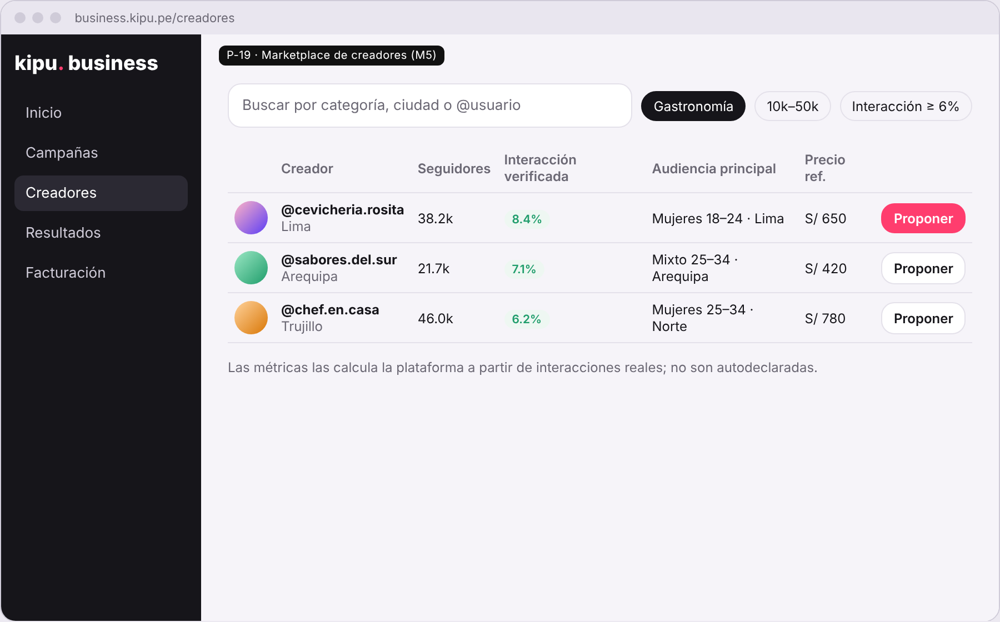
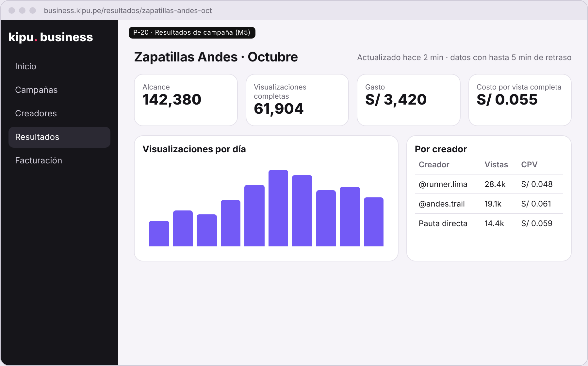

> [2. Requisitos del Sistema](../../2.md) › [2.1. Requisitos Funcionales](../2.1.md) › [2.1.7. Prototipos de Interfaz (Unificado)](2.1.7.md)

# 2.1.7. Prototipos de Interfaz (Unificado)

Los prototipos unifican las tres superficies del producto: app móvil, web pública y Business Suite. Abajo se muestran las capturas de las pantallas críticas de los flujos completos. El archivo navegable (Figma) se enlaza aquí: **[Prototipo KIPU en Figma](https://www.figma.com/)** *(reemplazar por el enlace del archivo del grupo)*.

### Capturas de los flujos principales

**Flujo del espectador: registro y consumo del feed (M1, M3, M2, M5)**

| P-02 Registro | P-03 Feed "Para ti" en modo respaldo | P-03 Anuncio en la posición 4 |
|---|---|---|
|  |  |  |

**Flujo del creador: publicar, seguir el procesamiento, aplicar a campañas y cobrar (M2, M5)**

| P-09 Publicar | P-10 Estado del procesamiento | P-16 Campañas | P-15 Billetera |
|---|---|---|---|
|  |  |  |  |

**Flujo de la marca en la Business Suite: crear campaña, contratar creadores y medir (M5)**

Cada pantalla refleja decisiones de la arquitectura: el aviso de "contenido popular" en P-03 es el modo respaldo de T-M3-03; la etiqueta "Publicidad" en P-03b responde a RL-02; el mensaje de revisión demorada en P-10 es la falla segura de T-M2-04; el estimador con mínimo de 1,000 personas en P-18 protege la privacidad; y la hora de actualización en P-20 declara el desfase de ADR-M5-04.

### Cobertura

| # | Pantalla | Módulo(s) | Actor | Estado |
|---|---|---|---|---|
| P-01 | Onboarding y selección de intereses | M1, M3 | Usuario nuevo | Por completar en Figma |
| P-02 | Registro / inicio de sesión | M1 | Visitante | Capturado (arriba) |
| P-03 | Feed "Para ti" | M3, M2, M5 | Usuario | Capturado (arriba) |
| P-04 | Feed "Siguiendo" | M3, M4 | Usuario | Por completar en Figma |
| P-05 | Panel de comentarios | M4 | Usuario | Por completar en Figma |
| P-06 | Perfil propio | M1, M2 | Usuario / Creador | Por completar en Figma |
| P-07 | Perfil de terceros | M1, M4 | Usuario | Por completar en Figma |
| P-08 | Cámara / selector de video | M2 | Creador | Por completar en Figma |
| P-09 | Pantalla de publicación (metadatos) | M2 | Creador | Capturado (arriba) |
| P-10 | Estado de procesamiento | M2 | Creador | Capturado (arriba) |
| P-11 | Búsqueda y tendencias | M3 | Usuario | Por completar en Figma |
| P-12 | Bandeja de notificaciones | M4 | Usuario | Por completar en Figma |
| P-13 | Mensajería directa | M4 | Usuario | Por completar en Figma |
| P-14 | Estudio del creador (analítica) | M5 | Creador | Por completar en Figma |
| P-15 | Billetera y retiros | M5 | Creador | Capturado (arriba) |
| P-16 | Bandeja de propuestas de campaña | M5, M4 | Creador | Capturado (arriba) |
| P-17 | Business Suite – inicio | M5 | Marca | Por completar en Figma |
| P-18 | Creación de campaña (asistente de 4 pasos) | M5 | Marca | Capturado (arriba) |
| P-19 | Marketplace de creadores | M5 | Marca | Capturado (arriba) |
| P-20 | Tablero de resultados de campaña | M5 | Marca | Capturado (arriba) |
| P-21 | Facturación y comprobantes | M5 | Marca | Por completar en Figma |
| P-22 | Consola de moderación | M1, M2 | Moderador | Por completar en Figma |
| P-23 | Configuración y privacidad | M1 | Usuario | Por completar en Figma |
| P-24 | Estados de error y vacío | Todos | Todos | Por completar en Figma |

### Descripción de las pantallas críticas

**P-03 — Feed "Para ti".**
Video a pantalla completa en formato vertical, reproducción automática con audio activado y avance por deslizamiento vertical.
*Opciones disponibles:* reacción, comentar, compartir, guardar, seguir al creador, ir al perfil, ir al sonido, mantener pulsado para "no me interesa" o reportar.
*Flujo de datos:* al abrir, el cliente solicita `GET /v1/feed/for-you?limit=10`. M3 devuelve los identificadores ordenados y M2 los hidrata con la URL del manifiesto HLS y la miniatura. En la posición 4 el elemento devuelto puede provenir de M5, en cuyo caso se muestra la etiqueta "Publicidad" y el botón de llamada a la acción. Al llegar al séptimo video, el cliente pide la siguiente página con el cursor. Cada video visto emite `feed.impression` y, al completarse, `feed.video_completed`.

**P-09 — Pantalla de publicación.**
Formulario posterior a la grabación o selección del archivo.
*Opciones disponibles:* miniatura (elegida entre 5 fotogramas o subida), descripción con sugerencia de hashtags, menciones, ubicación, audio de la biblioteca, visibilidad (público / solo seguidores / privado), permitir comentarios, permitir descargas, marcar como contenido patrocinado y vincular a una campaña activa, publicar ahora o programar.
*Flujo de datos:* `POST /v1/uploads` devuelve la URL prefirmada; el cliente sube por fragmentos directamente al almacenamiento; `POST /v1/uploads/{id}/complete` dispara el pipeline. La pantalla se cierra sin esperar el procesamiento y el estado se sigue desde P-10.

**P-18 — Creación de campaña (asistente de 4 pasos).**
*Paso 1 – Objetivo:* alcance, visualizaciones, tráfico o conversiones.
*Paso 2 – Audiencia:* ubicación, edad, género, intereses y audiencias propias, con estimador de alcance que se recalcula en vivo y bloquea la continuación si la audiencia es menor a 1,000 personas.
*Paso 3 – Creatividad y presupuesto:* selección o subida del video, texto, llamada a la acción, presupuesto diario o total, fechas y puja.
*Paso 4 – Revisión:* resumen, estimación de resultados, aceptación de políticas publicitarias y confirmación de pago.
*Flujo de datos:* cada paso persiste un borrador (`PATCH /v1/campaigns/{id}`); el estimador consulta un endpoint de estimación que no compromete presupuesto. Al confirmar, la campaña pasa a `EN_REVISIÓN` y se cobra o reserva el saldo.

**P-19 — Marketplace de creadores.**
Lista de tarjetas con foto, `@handle`, categoría, seguidores, tasa de interacción verificada, demografía principal de su audiencia y precio referencial por publicación.
*Opciones disponibles:* filtros (categoría, país, rango de seguidores, interacción mínima, presupuesto), ordenamiento, comparador de hasta 4 creadores, guardar en lista, enviar propuesta.
*Flujo de datos:* `GET /v1/creators/search` consulta el índice construido por M5 a partir de las métricas agregadas de M4 y M2; ninguna cifra proviene de lo declarado por el creador.

**P-20 — Tablero de resultados de campaña.**
*Opciones disponibles:* rango de fechas, comparación entre conjuntos de anuncios y entre creadores, desglose por demografía y geografía, exportación a CSV y PDF, pausar o ajustar presupuesto sin salir de la pantalla.
*Flujo de datos:* `GET /v1/analytics/campaigns/{id}` consulta el almacén columnar alimentado por el flujo de eventos. La pantalla indica de forma explícita la marca de tiempo de los últimos datos disponibles ("actualizado hace 2 minutos"), porque la latencia de hasta 5 minutos es una característica declarada del sistema y no puede presentarse como si fuera dato en vivo.

**P-24 — Estados de error y vacío.**
Se prototipan explícitamente porque varios requisitos de calidad se apoyan en ellos: feed servido en modo degradado (banner discreto "mostrando contenido popular"), video en procesamiento, video rechazado por moderación con acceso a la apelación, sin conexión con contenido en caché, campaña sin presupuesto y retiro rechazado por datos bancarios inválidos.

### Sistema de diseño

Tipografía, paleta, espaciado, iconografía y componentes base (botón, tarjeta de video, campo de texto, modal, *toast*, estado vacío) están definidos como biblioteca compartida en Figma, de modo que las tres superficies —app, web pública y Business Suite— mantengan consistencia visual y el equipo pueda construir pantallas nuevas sin rediseñar elementos.

---

[⬅️ Anterior](../2.1.6/2.1.6.md) | [🏠 Home](../../../README.md)
