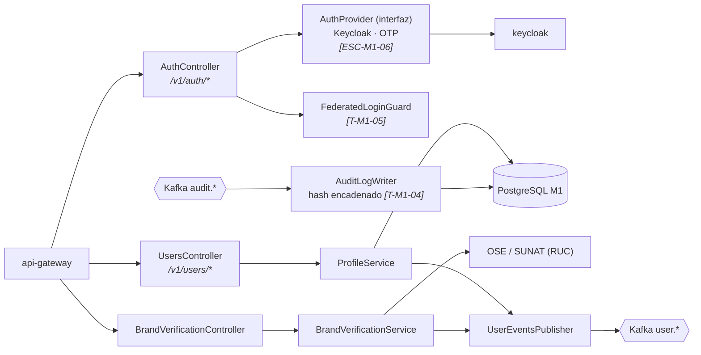
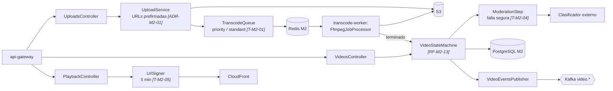
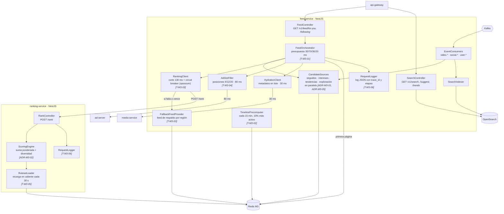
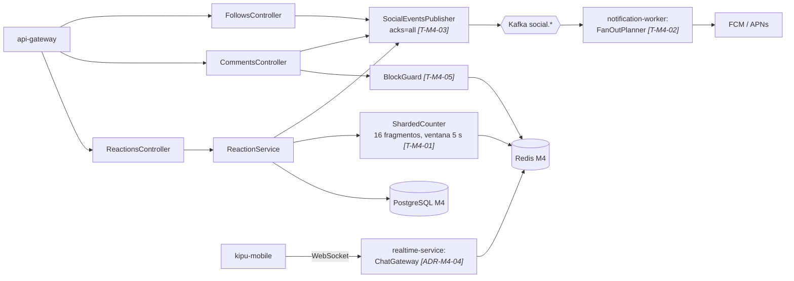
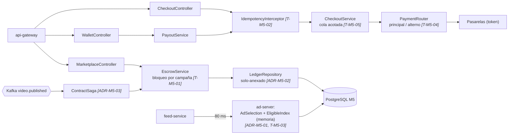

> [6. Documentación de Arquitectura (Bosquejo)](../6.md) › [6.3. Diagrama de Componentes](6.3.md)

# 6.3. Diagrama de Componentes

El diagrama de componentes entra en cada contenedor y muestra su estructura interna. Todos los servicios NestJS siguen la misma organización por capas (*controller* → *service* → *repository/client*), y los componentes coinciden con las carpetas de código de la sección 7. Se presenta un diagrama por módulo; cada integrante es responsable del suyo.

## 6.3.1. M1 — `identity-service` (CHUNG)

Si el diagrama no se dibuja, ver la [imagen exportada](img/6.3_0.png).

| Componente | Responsabilidad | Decisión / táctica |
|---|---|---|
| `AuthController` + `AuthProvider` | Registro e inicio de sesión a través de una interfaz con implementaciones para Keycloak y OTP. | ADR-M1-01, ESC-M1-06 |
| `FederatedLoginGuard` | Circuit breaker por proveedor federado. | T-M1-05 |
| `ProfileService` | Perfiles y proyección pública; publica `user.profile_updated`. | ADR-M1-03 |
| `BrandVerificationService` | Verificación de marca con RUC. | RF-M1-06 |
| `AuditLogWriter` | Persiste la bitácora encadenada. | T-M1-04 |

## 6.3.2. M2 — `media-service` y `transcode-worker` (HIDALGO)

Si el diagrama no se dibuja, ver la [imagen exportada](img/6.3_1.png).

| Componente | Responsabilidad | Decisión / táctica |
|---|---|---|
| `UploadService` | Emite URLs prefirmadas por partes y confirma la subida. | ADR-M2-01 |
| `TranscodeQueue` / `FfmpegJobProcessor` | Colas con prioridad y procesamiento idempotente con FFmpeg. | ADR-M2-02, T-M2-01, T-M2-03 |
| `VideoStateMachine` | Estados del video y publicación de eventos. | RF-M2-13 |
| `ModerationStep` | Clasificación previa y cola humana ante falla. | T-M2-04 |
| `UrlSigner` | URLs firmadas de reproducción. | T-M2-05 |

## 6.3.3. M3 — `feed-service` y `ranking-service` (RENGIFO)

Si el diagrama no se dibuja, ver la [imagen exportada](img/6.3_2.png).

| Componente | Responsabilidad | Interacciones | Decisión / táctica |
|---|---|---|---|
| `FeedController` | Expone el feed paginado por cursor, valida los parámetros y propaga el `trace_id`. | `FeedOrchestrator`. | RF-M3-01, RF-M3-02 |
| `FeedOrchestrator` | Coordina las etapas con su presupuesto: candidatos, ranking, anuncio e hidratación; sirve la primera página desde el timeline precomputado si existe. | Todos los componentes de la etapa; Redis. | ADR-M3-01, T-M3-01 |
| `CandidateSources` | Consulta en paralelo las cuatro fuentes y excluye lo ya visto (filtro de Bloom). | Redis (`candidates:*`, `seen:*`). | ADR-M3-01, ADR-M3-05, RF-M3-10 |
| `RankingClient` | Llama a `ranking-service` con un corte de 130 ms; abre el circuito tras 5 fallos o más del 50% de errores en 10 s. | `ranking-service`; `FallbackFeedProvider`. | T-M3-03 |
| `FallbackFeedProvider` | Entrega el feed de respaldo precomputado por región e intereses. | Redis (`fallback:*`). | T-M3-03, RF-M3-11 |
| `AdSlotFiller` | Pide el anuncio de cada posición con 80 ms de límite; si no llega, rellena con orgánico y registra la pérdida de inventario. | `ad-server`. | T-M3-04, RF-M3-09 |
| `HydrationClient` | Obtiene en lote metadatos y URLs firmadas de los 10 videos. | `media-service`. | ADR-G-02 |
| `TimelinePrecomputer` | Tarea programada que precomputa la primera página del 10% más activo. | Redis (`timeline:*`). | T-M3-02 |
| `EventConsumers` | Consumen `video.*`, `social.*` y `user.*` de forma idempotente y actualizan candidatos e índice. | Kafka; `CandidateSources`; `SearchIndexer`. | ADR-M4-03 |
| `SearchController` / `SearchIndexer` | Búsqueda, autocompletado y tendencias sobre el índice propio. | OpenSearch. | ADR-M3-04 |
| `RequestLogger` (ambos servicios) | Escribe un log JSON por petición: `trace_id`, latencia total y por etapa, `fallback`, versión del ruleset. | Observabilidad. | ADR-G-06, T-M3-06 |
| `RankController` | Recibe candidatos y devuelve el top 10 con sus puntajes y la versión de reglas. | `ScoringEngine`. | ADR-M3-02 |
| `ScoringEngine` | Calcula la suma ponderada (afinidad, región, interacción, frescura), aplica penalizaciones y diversidad. | `RulesetLoader`. | ADR-M3-02, RE-02 |
| `RulesetLoader` | Lee la versión activa y el porcentaje de la candidata desde Redis; asigna versión por hash de `user_id`. | Redis (`ruleset:active`). | T-M3-05 |

## 6.3.4. M4 — `social-service`, `realtime-service`, `notification-worker` (RODRIGUEZ)

Si el diagrama no se dibuja, ver la [imagen exportada](img/6.3_3.png).

| Componente | Responsabilidad | Decisión / táctica |
|---|---|---|
| `ReactionService` + `ShardedCounter` | Registra el hecho y actualiza el contador fragmentado. | ADR-M4-01, T-M4-01 |
| `BlockGuard` | Verifica bloqueos en escritura y lectura. | T-M4-05 |
| `SocialEventsPublisher` | Publica `social.*` con entrega al menos una vez. | ADR-M4-03, T-M4-03 |
| `ChatGateway` | Mensajería por WebSocket. | ADR-M4-04, T-M4-04 |
| `FanOutPlanner` | Lotes priorizados por afinidad con límite de tasa. | ADR-M4-02, T-M4-02 |

## 6.3.5. M5 — `campaign-service` y `ad-server` (compartido)

Si el diagrama no se dibuja, ver la [imagen exportada](img/6.3_4.png).

| Componente | Responsabilidad | Decisión / táctica |
|---|---|---|
| `IdempotencyInterceptor` | Garantiza que un reintento no duplique un cobro o una liquidación. | T-M5-02 |
| `CheckoutService` / `PaymentRouter` | Checkout encolado y conmutación de pasarela. | T-M5-04, T-M5-05, ADR-M5-05 |
| `EscrowService` / `LedgerRepository` | Compromisos de escrow serializados por campaña sobre el libro contable. | T-M5-01, ADR-M5-02 |
| `ContractSaga` | Saga de contratación y liberación por evento de publicación. | ADR-M5-03 |
| `AdSelection` + `EligibleIndex` | Selección del anuncio con un índice en memoria. | ADR-M5-01, T-M5-03 |

---

[⬅️ Anterior](../6.2/6.2.md) | [🏠 Home](../../README.md) | [Siguiente ➡️](../6.4/6.4.md)
